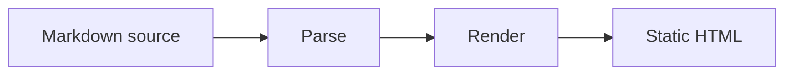
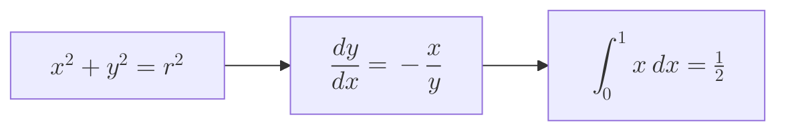

# Math And Diagrams

Papers typesets TeX with [KaTeX](https://katex.org) and renders Mermaid diagrams, including
diagrams whose labels contain math. KaTeX loads only on pages that contain math.

## Inline Math

Wrap TeX in single dollars: the identity $e^{i\pi} + 1 = 0$ links five constants, and
$\sum_{k=1}^{n} k = \frac{n(n+1)}{2}$ sums a series.

Prices stay plain text: this costs $5 and that costs $10. Escape a literal dollar as `\$`.

## Display Math

Use a `$$` block:

$$
\int_{-\infty}^{\infty} e^{-x^2}\,dx = \sqrt{\pi}
$$

Or a fenced `math` block:

```math
\mathbf{A} = \begin{pmatrix} a & b \\ c & d \end{pmatrix}, \qquad \det \mathbf{A} = ad - bc
```

## Mermaid Diagrams



## Mermaid With Math Labels

Put `$$...$$` inside a label. Diagrams with math use HTML labels and native MathML.



## Compatibility

Papers depends on `katex` `^0.16.47 || ^0.18.10`. Mermaid 11 also bundles KaTeX for diagram
labels, so a project that pins KaTeX with npm `overrides` (for example `"katex": "0.18.10"`)
gets the same version for both. TeX is rendered with `trust: false`, so commands such as
`\href` and `\includegraphics` are disabled.
