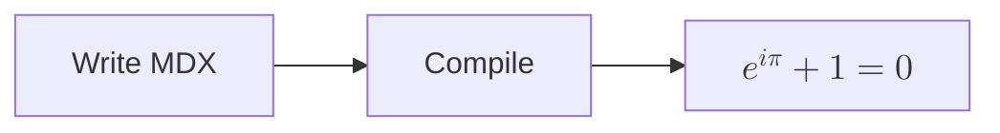

# Math And Diagrams In MDX

`.mdx` pages support the same math and Mermaid syntax as Markdown pages.

## Inline

The quadratic formula is $x = \frac{-b \pm \sqrt{b^2 - 4ac}}{2a}$. Prices like $5 or $10
stay plain text.

## Display

$$
\nabla \cdot \mathbf{E} = \frac{\rho}{\varepsilon_0}
$$

```math
f(x) = \sum_{n=0}^{\infty} \frac{f^{(n)}(a)}{n!}(x - a)^n
```

## Diagrams



> [!NOTE]
> Math works next to MDX shortcodes such as callouts and `<CharacterNote>`.
