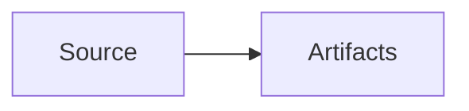

# Content Engine Fixture

This fixture exercises the native source-to-artifact contract.

## Details

Use the [details anchor](#details), the [OpenAPI asset](/openapi-v1.yaml), or
the [external reference](https://example.com/reference) when testing links.

<Callout type="note" title="Fixture">
  The component is expected to compile into sanitized HTML.
</Callout>

<Tabs>
  <Tab label="Native">Native content.</Tab>
  <Tab label="Adapter">Adapter boundary.</Tab>
</Tabs>

```ts
export const fixture = true;
```


